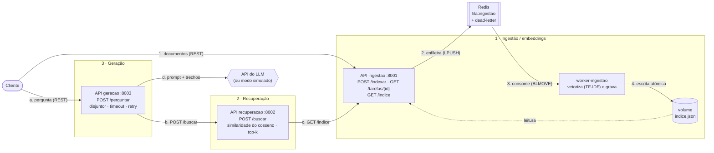

# RAG Distribuído em Microsserviços — C2.A2

**Sistemas Distribuídos e Computação em Nuvem · FAESA · 2026/2**
Trabalho C2.A2, construído sobre o [kit de partida](https://github.com/howardroatti/sd-2026-2-kit-c2a2)
do Prof. M.Sc. Howard Roatti.

Sistema de perguntas e respostas com **RAG** (geração aumentada por recuperação) dividido em
**três microsserviços independentes**: ingestão, recuperação e geração. Os serviços conversam
por **REST**, a ingestão passa por uma **fila Redis** com worker, e a chamada ao LLM é protegida
por **tempo-limite, retentativa com backoff e circuit breaker**. Tudo funciona **offline**:
sem chave de API o LLM entra em modo simulado.

---

## Arquitetura



<details>
<summary>Versão em texto do diagrama</summary>

```
                         INDEXAÇÃO (assíncrona, por fila)
 cliente ──POST /indexar──> [1] ingestao:8001 ──LPUSH──> Redis fila:ingestao ──BLMOVE──> worker-ingestao
            <── 202 + id ──      │    ▲                        │ (3 falhas)                  │
                                 │    └── lê ── indice.json <──┼───── grava (atômica) ───────┘
                                 │                             └──> fila:ingestao:dlq
                         PERGUNTA (síncrona, por REST)
 cliente ──POST /perguntar──> [3] geracao:8003 ──POST /buscar──> [2] recuperacao:8002 ──GET /indice──> [1]
            <── resposta ───        │  disjuntor + timeout
                                    └──(disjuntor ▸ retry c/ backoff ▸ timeout)──> API do LLM / simulado
```
</details>

### Os três serviços

| # | Serviço | Porta | Responsabilidade | Rotas |
|---|---------|-------|------------------|-------|
| 1 | **ingestao** + **worker-ingestao** | 8001 | Recebe documentos, enfileira, vetoriza e persiste o índice | `POST /indexar` (202), `GET /tarefas/{id}`, `GET /indice`, `GET /saude` |
| 2 | **recuperacao** | 8002 | Dada uma pergunta, devolve os `top_k` trechos mais similares | `POST /buscar`, `GET /saude` |
| 3 | **geracao** | 8003 | Monta o prompt com os trechos e chama o LLM com resiliência | `POST /perguntar`, `GET /saude` |

Cada serviço tem diretório, app FastAPI e `Dockerfile` próprios, e nenhum importa código de
outro: o único código compartilhado é `servicos/comum` (vetorizador, cliente de LLM e circuit
breaker). A documentação OpenAPI de cada um fica em `http://localhost:<porta>/docs`.

### Comunicação

- **REST** entre os serviços no caminho da pergunta: geração → recuperação → ingestão.
  É síncrono porque o usuário está esperando a resposta. Toda chamada tem tempo-limite.
- **Mensageria** na indexação: `POST /indexar` só enfileira a tarefa no Redis e devolve
  **202 Accepted** com um identificador; o worker processa depois. A fila desacopla a API
  do processamento pesado (vetorização) e absorve picos: se chegam documentos mais rápido do
  que o worker processa, eles esperam na fila em vez de derrubar a API.
  - **Fila confiável:** o worker move a mensagem atomicamente para `fila:ingestao:processando`
    (`BLMOVE`) e só a remove depois de tratada. Se ele cair no meio, a mensagem volta à fila.
  - **Retentativa e dead-letter:** uma tarefa que falha volta à fila até 3 vezes; depois vai
    para `fila:ingestao:dlq` com o erro, sem travar o fluxo principal.
  - **Idempotência:** o id de cada documento é `sha256(origem + texto)`, então reprocessar
    uma mensagem (entrega *at-least-once*) não duplica documentos.

### Resiliência na chamada ao LLM

```
disjuntor_llm.chamar( com_retentativa( llm.gerar com tempo-limite ) )
```

| Padrão | Como | Configuração (variáveis de ambiente) |
|--------|------|--------------------------------------|
| **Tempo-limite** | `requests.post(..., timeout=)` no cliente do LLM | `LLM_TIMEOUT` = 20 s |
| **Retentativa** | backoff exponencial com jitter (≈0,5 s, ≈1 s…), só para falhas transitórias: timeout, conexão, HTTP 5xx e 429. Um 4xx não é retentado | `LLM_RETENTATIVAS` = 3, `LLM_BACKOFF_BASE` = 0,5 |
| **Circuit breaker** | abre após N falhas seguidas, recusa na hora enquanto aberto e, passada a espera, deixa passar **uma** chamada de teste | `LLM_LIMITE_FALHAS` = 3, `LLM_ESPERA_DISJUNTOR` = 20 s |

- A retentativa fica **dentro** do disjuntor: uma sequência de tentativas esgotada conta como
  uma falha.
- **Degradação elegante:** com o circuito aberto ou as tentativas esgotadas, `/perguntar`
  devolve **503** com header `Retry-After`, uma mensagem clara e **os trechos e fontes já
  recuperados**. Nunca devolve um 500 com traceback.
- A chamada geração → recuperação tem **tempo-limite e um disjuntor próprio**: se a
  recuperação cair, a geração responde 503 imediatamente em vez de acumular chamadas
  travadas (falha em cascata). Se a ingestão cair, a recuperação responde 503.
- Retentar a geração é seguro porque ela não tem efeito colateral (é idempotente).
- `GET :8003/saude` mostra o modo do LLM (`api` ou `simulado`) e o estado dos dois disjuntores.

### Consistência do índice

O índice fica em `indice.json`, num volume compartilhado entre a API de ingestão e o worker.
**Só o worker escreve**, sempre de forma **atômica** (grava num arquivo temporário e usa
`os.replace`), então quem lê vê o índice anterior inteiro ou o novo inteiro, nunca um arquivo
pela metade. O modelo é de **consistência eventual**: um documento enviado aparece nas buscas
assim que o worker termina de processá-lo (acompanhe em `/tarefas/{id}`). Para o caso de uso
(base de conhecimento consultada por perguntas) um atraso de milissegundos é aceitável, e em
troca a ingestão nunca bloqueia nem perde pedidos. Com vários workers seria necessário um lock
distribuído (ex.: no Redis) para manter um único escritor por vez.

O índice e a fila sobrevivem a reinícios: o índice fica no volume `indice-dados` e o Redis
roda com AOF no volume `redis-dados`.

---

## Como executar do zero

### Pré-requisitos

- **Docker** com Docker Compose v2 (`docker compose version`).
- Para os scripts e testes: **Python 3.10+** (recomendado 3.12).

### 1. Clonar e configurar

```bash
git clone https://github.com/feumpi/sd-2026-2-kit-c2a2.git
cd sd-2026-2-kit-c2a2
cp .env.example .env      # opcional: LLM_API_KEY vazia = modo simulado (offline)
```

### 2. Subir os serviços

```bash
docker compose up -d --build --wait
docker compose ps          # redis, ingestao, worker-ingestao, recuperacao e geracao "healthy"/"Up"
```

### 3. Ambiente Python (para o script de carga e os testes)

```bash
python3 -m venv .venv
source .venv/bin/activate            # Windows: .venv\Scripts\activate
pip install -r requirements.txt -r requirements-dev.txt
```

### 4. Indexar os documentos de exemplo

```bash
python scripts/carregar_documentos.py
# 3 documento(s) enfileirado(s) - tarefa 5b97...
# indexacao concluida: 3 novo(s), 3 no indice
```

Ou diretamente pela API:

```bash
curl -X POST http://localhost:8001/indexar -H "Content-Type: application/json" \
  -d '[{"texto":"O teorema CAP trata de consistencia e disponibilidade.","origem":"aula10"}]'
# {"tarefa":"da32...","estado":"pendente","documentos":1,"acompanhar":"/tarefas/da32..."}
curl http://localhost:8001/tarefas/<id>       # estado: concluida
```

### 5. Perguntar

```bash
curl -X POST http://localhost:8003/perguntar -H "Content-Type: application/json" \
  -d '{"pergunta":"o que diz o teorema CAP?"}'
```

```json
{
  "pergunta": "o que diz o teorema CAP?",
  "resposta": "[MODO SIMULADO - sem LLM_API_KEY configurada]\nPergunta: o que diz o teorema CAP?\nCom base nos documentos recuperados: O teorema CAP afirma que, diante de uma particao de rede, ...",
  "contexto": ["O teorema CAP afirma que, diante de uma particao de rede, ..."],
  "fontes": ["teorema_cap.txt", "..."]
}
```

Para usar um LLM real, preencha `LLM_API_KEY` (e, se preciso, `LLM_API_URL`/`LLM_MODELO`,
compatíveis com a API de chat completions da OpenAI) no `.env` e recrie o serviço:
`docker compose up -d geracao`. **A chave nunca vai para o código nem para o git:** o `.env`
está no `.gitignore`.

### Parar

```bash
docker compose down        # mantém índice e fila
docker compose down -v     # apaga também os volumes (recomeça do zero)
```

### Execução local sem containers (opcional)

Com o ambiente Python ativo e só o Redis no Docker, um processo por terminal:

```bash
docker compose up -d redis
set -a; source .env; set +a       # em cada terminal: carrega as variáveis do .env
uvicorn servicos.ingestao.app:app    --port 8001
python -m servicos.ingestao.worker
uvicorn servicos.recuperacao.app:app --port 8002
uvicorn servicos.geracao.app:app     --port 8003
```

---

## Testes

```bash
python -m pytest              # 48 testes unitários: sem rede, sem Docker, sem chave de API
python -m pytest -m e2e       # ponta a ponta contra o docker compose no ar
```

- **Unitários** (`tests/`): índice persistido, busca por similaridade, circuit breaker,
  retentativa e degradação na geração, fila e worker (com `fakeredis`).
- **Ponta a ponta** (`tests/test_e2e.py`): indexa `documentos/` pela fila, pergunta e confere
  as fontes, verifica a idempotência e **derruba o serviço de recuperação** para ver o
  disjuntor abrir e, ao religá-lo, fechar sozinho (leva ~25 s).

### Provocando falhas à mão

```bash
# Recuperação fora do ar -> 503 e disjuntor da recuperação aberto
docker compose stop recuperacao
curl -X POST localhost:8003/perguntar -H "Content-Type: application/json" -d '{"pergunta":"CAP"}'   # x3
curl localhost:8003/saude          # "recuperacao": "aberto"
docker compose start recuperacao   # após ~20 s a chamada de teste passa e o disjuntor fecha

# LLM inacessível (simula queda da internet com chave configurada)
printf 'LLM_API_KEY=ficticia\nLLM_API_URL=http://127.0.0.1:9/\nLLM_TIMEOUT=2\n' > .env
docker compose up -d geracao
# 3 perguntas: 503 após ~2 s (3 tentativas com backoff); a 4ª: 503 imediato, com Retry-After
rm .env && docker compose up -d geracao     # volta ao modo simulado

# Sem internet e sem chave: o modo simulado mantém o sistema de pé
```

---

## Estrutura do projeto

```
├── servicos/
│   ├── comum/                    # código compartilhado
│   │   ├── embeddings.py         # vetorizador TF-IDF + similaridade do cosseno (kit)
│   │   ├── llm.py                # cliente do LLM com modo simulado (kit)
│   │   └── circuit_breaker.py    # disjuntor thread-safe
│   ├── ingestao/                 # Serviço 1
│   │   ├── app.py                # API: /indexar (enfileira), /tarefas, /indice
│   │   ├── fila.py               # fila Redis: enfileirar, estado das tarefas
│   │   ├── worker.py             # consumidor: retentativa, dead-letter, recuperação
│   │   ├── indice.py             # índice persistido em JSON (escrita atômica)
│   │   └── Dockerfile
│   ├── recuperacao/              # Serviço 2
│   │   ├── app.py                # /buscar: top-k por similaridade
│   │   └── Dockerfile
│   └── geracao/                  # Serviço 3
│       ├── app.py                # /perguntar: disjuntores e degradação elegante
│       ├── resiliencia.py        # retentativa com backoff exponencial + jitter
│       └── Dockerfile
├── scripts/carregar_documentos.py
├── tests/                        # unitários + e2e
├── documentos/                   # base de exemplo
├── docker-compose.yml
├── IMPLEMENTACAO.md              # diário de desenvolvimento, tarefa a tarefa
└── TAREFAS.md
```

## Variáveis de ambiente

| Variável | Serviço | Padrão | Descrição |
|----------|---------|--------|-----------|
| `LLM_API_KEY` | geracao | *(vazia)* | Chave do LLM; vazia = modo simulado |
| `LLM_API_URL`, `LLM_MODELO` | geracao | OpenAI, `gpt-4o-mini` | Endpoint de chat completions |
| `LLM_TIMEOUT` | geracao | 20 | Tempo-limite da chamada ao LLM (s) |
| `LLM_RETENTATIVAS`, `LLM_BACKOFF_BASE` | geracao | 3, 0,5 | Retentativa com backoff |
| `LLM_LIMITE_FALHAS`, `LLM_ESPERA_DISJUNTOR` | geracao | 3, 20 | Disjuntor do LLM |
| `RECUPERACAO_LIMITE_FALHAS`, `RECUPERACAO_ESPERA_DISJUNTOR` | geracao | 3, 20 | Disjuntor da recuperação |
| `URL_RECUPERACAO`, `TIMEOUT_RECUPERACAO`, `TOP_K` | geracao | localhost:8002, 5, 3 | Chamada à recuperação |
| `URL_INGESTAO`, `TIMEOUT_INGESTAO` | recuperacao | localhost:8001, 5 | Chamada à ingestão |
| `REDIS_URL` | ingestao, worker | `redis://localhost:6379/0` | Fila |
| `DIR_DADOS` | ingestao, worker | `dados` | Pasta do `indice.json` |
| `INGESTAO_MAX_TENTATIVAS` | worker | 3 | Tentativas antes da dead-letter |

No `docker compose`, as URLs internas (`http://ingestao:8001` etc.) já vêm definidas no
`docker-compose.yml`. O `.env` só é necessário para configurar o LLM.

---

Kit de partida © 2026 Howard Cruz Roatti — FAESA, sob licença MIT (ver `LICENSE`).
